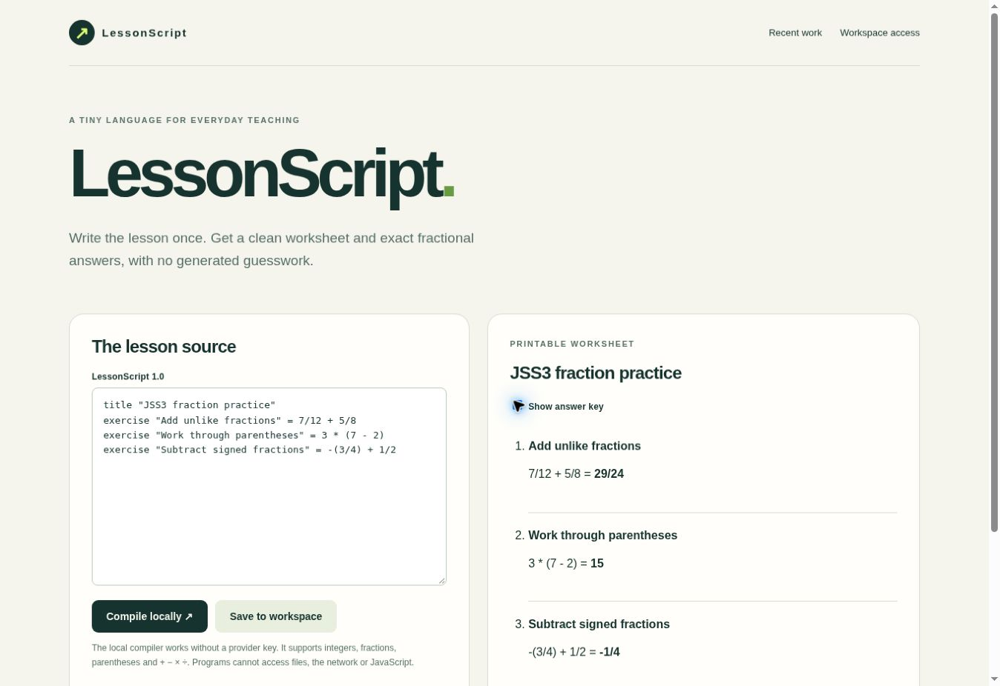

# Vercel hosting and remaining acceptance — 27 October 2026

Seven separate web projects are deployed in `emmanuel-dukes-projects`. Their latest GitHub-linked production-target deployments report **READY**. Signing secrets, independent operator/judge access codes, cron secrets and exact production origins are configured as project environment variables; secret values are not included in this repository. The native UGREEN HandoverShelf package has no Vercel requirement.

Hosting and dedicated Neon database setup are complete. **154 live backend assertions passed**; see [database verification](DEVPOST-BACKENDS.md). The applications are not yet claimed production-ready or submitted: sponsor credentials, event-specific eligibility, recordings and acceptance evidence remain pending.

| Project | Live URL | Remaining configuration |
| --- | --- | --- |
| FieldBrief | https://fieldbrief-devpost-2026.vercel.app/ | NEBIUS_API_KEY, an available NVIDIA model identifier |
| CultureRoute | https://cultureroute-devpost-2026.vercel.app/ | QLOO_API_KEY; real Gateway/Qloo agent run still unverified |
| CrowdQuest | https://crowdquest-devpost-2026.vercel.app/ | TWITCH_BROADCASTER_ID, OAuth/EventSub subscription and genuine Codex session ID |
| FitReceipt | https://fitreceipt-devpost-2026.vercel.app/ | YOUCAM_API_KEY and successful consent/upload/try-on |
| ReLoop | https://reloop-devpost-2026.vercel.app/ | Student eligibility hold remains |
| LessonScript | https://lessonscript-devpost-2026.vercel.app/ | Eligibility conflict remains |
| RhythmWeave | https://rhythmweave-devpost-2026.vercel.app/ | Eligibility conflict remains |

Exact team, project, deployment and commit identifiers, configured key names and health responses are in [vercel-deployments.json](../deploy/vercel-deployments.json). GitHub publication records are an earlier snapshot; use the deployment ledger for the currently deployed commits.

## Verified behavior

- At the initial hosting check, all seven configuration endpoints returned HTTP 200 and identified missing backend configuration. The database gap was subsequently resolved and the live flows were verified in DEVPOST-BACKENDS.md. A 200 configuration response is not evidence of a working database or sponsor API.
- Plain public requests to the CrowdQuest, FitReceipt and ReLoop homepages returned HTTP 200 with the matching application titles; [response checks](../deploy/public-root-checks.json) contain no credentials or share links.
- FieldBrief's page rendered in the browser. Submitting the fictional sample without a workspace session displayed the access-code requirement; no brief or successful model request was claimed.
- CultureRoute's product page rendered. `/eve/v1/health` returned `ok: true`, `status: ready` and its workflow identifier. This verifies the transport, not an actual agent run.
- CultureRoute's initial health check incorrectly checked only an environment token. It now calls the official `getVercelOidcToken` helper, which also reads the request context. Its five tests, TypeScript check, Eve build and Next build passed again. A plain public HTTPS health request verified the fix. After Neon provisioning, only QLOO_API_KEY remains missing. Credentials are never returned by the endpoint.
- LessonScript compiled a new worksheet in the deployed browser and displayed the exact results: `7/12 + 5/8 = 29/24`, `3 * (7 - 2) = 15`, and `-(3/4) + 1/2 = -1/4`.
- RhythmWeave's deployed controls changed the artwork and its accessible description from 24 steps/rotation 0 to 25 steps/rotation 1, preserving nine pulses and eight rings.

Additional browser captures: [FieldBrief access check](screenshots/fieldbrief-deployed-2026-10-27.jpg) and [RhythmWeave controls](screenshots/rhythmweave-deployed-2026-10-27.jpg).

## Remaining acceptance

The Neon connection is active. Seven databases have been provisioned, migrated, connected using restricted runtime roles, redeployed and tested. The current records are in [DEVPOST-BACKENDS.md](DEVPOST-BACKENDS.md).

Configure the required sponsor credentials in Vercel, verify the real integration responses and record the required demos. Resolve eligibility holds and complete truthful entrant declarations before final submission. Automatic scheduled cleanup, database backup restoration, operating budgets and recovery still need acceptance before a general public launch.
