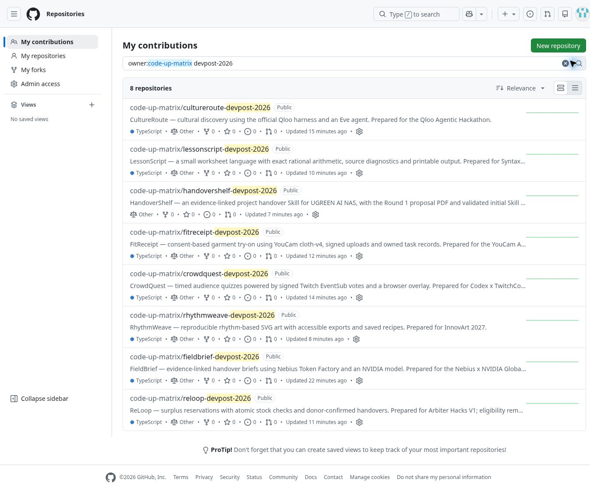

# Published Devpost repositories — 27 October 2026

Eight separate public repositories have been created and populated under `code-up-matrix`. Each contains its product source, license, configuration, verification evidence and event-specific submission material. The seven web applications have their own frontend, server routes and database migrations. HandoverShelf is a native UGREEN Skill with its Round 1 PDF and ZIP.

| Event | Repository | Local verification | Remaining requirement |
| --- | --- | --- | --- |
| Nebius × NVIDIA | [FieldBrief](https://github.com/code-up-matrix/fieldbrief-devpost-2026) | 8 tests; TypeScript and production build pass | Vercel/database setup, real NVIDIA inference on Nebius, demo and submission |
| Qloo | [CultureRoute](https://github.com/code-up-matrix/cultureroute-devpost-2026) | 5 tests; TypeScript, Eve and Next builds pass | Event API key, real Qloo/agent flow, deployment, demo and submission |
| Codex × TwitchCon | [CrowdQuest](https://github.com/code-up-matrix/crowdquest-devpost-2026) | 10 tests; TypeScript and production build pass | Twitch OAuth/EventSub/live voting, genuine Codex session ID, deployment, video and submission |
| YouCam | [FitReceipt](https://github.com/code-up-matrix/fitreceipt-devpost-2026) | 8 tests; TypeScript and production build pass | API access/quota, actual consent/upload/try-on, deployment, video and submission |
| Arbiter Hacks V1 | [ReLoop](https://github.com/code-up-matrix/reloop-devpost-2026) | 6 tests; TypeScript and production build pass | Student eligibility confirmation; deployment, database, demo and submission |
| Syntax Summit | [LessonScript](https://github.com/code-up-matrix/lessonscript-devpost-2026) | 9 tests; TypeScript and production build pass | Resolve eligibility conflict; deployment, database, demo and submission |
| InnovArt 2027 | [RhythmWeave](https://github.com/code-up-matrix/rhythmweave-devpost-2026) | 6 tests; TypeScript and production build pass | Resolve eligibility conflict; deployment, database, presentation and submission |
| UGREEN Round 1 | [HandoverShelf](https://github.com/code-up-matrix/handovershelf-devpost-2026) | Official static checker pass; proposal PDF visually checked | Entrant declarations and final Devpost upload; NAS runtime remains unverified |

The seven web projects account for 52 passing test executions, including repeated shared checks. Provider replies are stubbed where documented; database tests exercise PostgreSQL semantics using PGlite. No live provider success, production deployment or accepted submission has been verified.

All eight published `main` branches and complete Git tree file lists were read back and matched: 343 source/artifact files total. [Exact repository, commit and tree records](../deploy/published-repositories.json) preserve the verification timestamps. Published sources differ from the checked archives only in repository URLs and status documentation. The [original archives](../releases/repository-seeds/README.md) retain their export-time metadata and checksums.

Vercel access is currently blocked by a 403 missing team grant for `emmanuel-dukes-projects`. After that grant, each web project needs its own database and configured secrets before live acceptance testing. HandoverShelf has no Vercel requirement for Round 1.

These are eight prepared projects from the [52-event research snapshot](DEVPOST-CATALOG.md). The snapshot also includes expired events and entries with eligibility, native-platform or membership constraints; it does not mean 52 completed applications or submissions.

